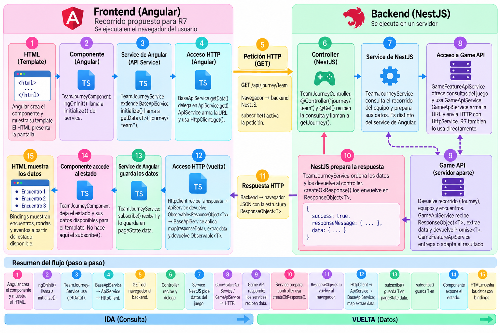
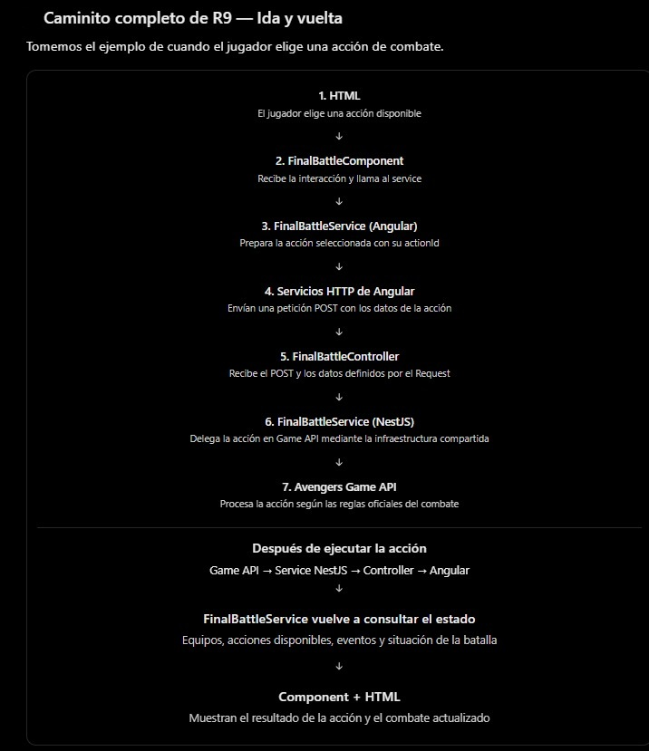

# Avengers: Multiversal War — Web Platform & Final Battle Engine

Full-stack web application designed for tournament progression tracking, detailed encounter inspection, and real-time turn-based combat for the Avengers Multiversal Tournament.

The system implements a decoupled three-tier architecture based on the Backend for Frontend (BFF) pattern, consuming an authoritative external Game API while maintaining domain integrity and eliminating unnecessary local persistence.

---

## Language Navigation
* [Versión en Español](#versión-en-español)
* [English Version](#english-version)

---

# Versión en Español

Plataforma web integral diseñada para la simulación, inspección cronológica y combate por turnos en tiempo real del Torneo Multiversal de Avengers.

El sistema implementa una arquitectura desacoplada de tres capas orientada al patrón Backend for Frontend (BFF), consumiendo la autoridad de juego de una API externa sin alterar sus reglas de dominio ni duplicar persistencia.

## Demostración en Video: Batalla Final (R9)

Visualización del motor de combate en vivo interactuando con la API oficial: resolución de turnos, validación de habilidades y objetivos legales, actualización de estados de recursos (Energy y AP) y gestión de narrativa en tiempo real.

<p align="center">
  <a href="https://www.youtube.com/watch?v=qKYB2739Z0I">
    
  </a>
</p>

<p align="center">
  <a href="https://www.youtube.com/watch?v=qKYB2739Z0I">▶ Ver demostración de la Batalla Final en YouTube</a>
  ·
  <a href="https://github.com/Elianayc/Avengers-Multiversal-War/blob/main/docs/R9/final_battle.mp4">Video MP4 en el repositorio</a>
</p>

## Alcance y Autoría Técnica

En este proyecto asumí el liderazgo técnico integral, la arquitectura de integración y el desarrollo de punta a punta de los dos módulos centrales del sistema:

1. **Camino del Equipo (R7):** Módulo individual de lectura cronológica y análisis táctico (Frontend Angular y BFF NestJS), normalizando datos sin duplicar rosters y permitiendo la inspección detallada de encuentros, rondas y eventos.
2. **Batalla Final (R9):** Motor de combate interactivo por turnos en tiempo real. Diseñé la arquitectura técnica, los contratos de comunicación y la implementación completa de punta a punta (controlador NestJS, servicios de orquestación, gestión de estado reactivo en Angular, cumplimiento estricto del protocolo `actionId` y sincronización atómica de eventos post-acción). Además, coordiné el aseguramiento de calidad, testing funcional de integración y soporte técnico continuo sobre el flujo general del sistema.

## Arquitectura del Sistema

```text
┌──────────────────────────────────────────────┐
│          Angular Frontend (Cliente)          │
│   Components · Feature Services · RxJS UI    │
└──────────────────────┬───────────────────────┘
                       │ HTTP (Contratos Tipados Propios)
                       ▼
┌──────────────────────────────────────────────┐
│            NestJS Backend (BFF)              │
│  Controllers · Services · Composición Async │
└──────────────────────┬───────────────────────┘
                       │ HTTP (REST / JSON)
                       ▼
┌──────────────────────────────────────────────┐
│           Avengers Game API Oficial          │
│  Reglas de Juego · RNG · SQLite · Narrativa  │
└──────────────────────────────────────────────┘
```

### Principios de Ingeniería Aplicados

* **Separación de Responsabilidades:** El cliente Angular no se comunica directamente con la API externa; consume exclusivamente endpoints adaptados y tipados provistos por el BFF.
* **Composición Concurrente:** Agregación de micro-recursos independientes mediante `Promise.all` en el backend para reducir latencias de red.
* **Manejo de Ciclo de Vida y Suscripciones:** Prevención activa de condiciones de carrera y fugas de memoria mediante la cancelación explícita de suscripciones (`Subscription.unsubscribe()`).
* **Seguridad y Validación en Backend:** Verificación de pertenencia de equipos para evitar la manipulación de identificadores por URL, respondiendo con excepciones HTTP 404 estructuradas.

## Módulos Desarrollados

### 1. R7 — Camino del Equipo (Team Journey)

* **Objetivo:** Visualizar el progreso del equipo asignado (Falcon) a lo largo del torneo e inspeccionar el detalle táctico de cada combate (rondas, iniciativas, daño y eventos).
* **BFF (NestJS):**
  * `getJourney()`: Orquesta en paralelo la consulta de estado, rosters y catálogo. Compone los nombres de héroes mediante diccionarios locales (`Record<string, string>`) para no duplicar datos y filtra los encuentros donde participa el equipo. Mapea el daño recibido a partir de los datos emitidos por el rival.
  * `getEncounter(id)`: Endpoint parametrizado `@Get('encounters/:encounterId')`. Valida la participación del equipo y arroja `NotFoundException` (404) si se intenta consultar una pelea ajena.
* **Frontend (Angular):**
  * Estados visuales desacoplados: `status` (timeline general) y `detailStatus` (detalle de pelea) para evitar bloqueos visuales durante la carga asincrónica.
  * `selectRound(index)`: Navegación sincrónica en memoria sobre las rondas ya descargadas.
  * `buildEventGroups()`: Algoritmo de presentación que asocia acciones (`ACTION`) con sus consecuencias (`DAMAGE`, `KO`, `HEAL`) para generar un log secuencial legible sin alterar los datos del juego.

Documentación y diagramas técnicos de R7:

* [Documentación interna detallada de R7 (README)](https://github.com/Elianayc/Avengers-Multiversal-War/blob/main/frontend/avengers-front/src/app/features/journey/team-journey/README.md)
* [Flujo de Datos (Data Flow)](./docs/R7/data_flow.png)
* [Mapa Mental de Componentes](./docs/R7/mind_map.png)

<p align="center">
  
</p>

### 2. R9 — Motor de Batalla Final (Final Battle)

* **Objetivo:** Ejecutar la final del torneo en tiempo real mediante un flujo de interacción por turnos gobernado por las acciones legales declaradas por el servidor.
* **Protocolo de Comandos y Manejo de `actionId`:**
  * El frontend consulta las acciones legales (`GET .../actions`). Cada habilidad viene identificada con un `actionId` opaco provisto por la Game API.
  * Al confirmar una orden, el cliente envía `POST .../play` con el payload `{ type: "CHOOSE_ACTION", actionId }` sin recalcular costos ni daño localmente.
* **Ciclo de Vida del Combate:**
  * Estados del combate: `READY` (esperando inicio con comando `START`), `ACTIVE` (combate en progreso con selección de héroe, habilidad y objetivo legal) y `COMPLETED` (resolución terminal: `VICTORY`, `DEFEAT` o `ABANDON`).
  * Sincronización post-acción: Ejecución inmediata de consultas paralelas para refrescar el estado del equipo propio, el estado del rival y la narrativa del turno.

Diagrama técnico de R9:

* [Flujo de Combate (Data Flow)](./docs/R9/data_flow.jpeg)

<p align="center">
  
</p>

## Endpoints del Backend for Frontend (BFF)

| Módulo | Método | Endpoint | Contrato de Retorno | Descripción |
| :--- | :--- | :--- | :--- | :--- |
| **R7** | `GET` | `/journey/team` | `ResponseObject<TeamJourneyModel>` | Resumen del camino, equipos consolidados y timeline |
| **R7** | `GET` | `/journey/team/encounters/:encounterId` | `ResponseObject<TeamJourneyDetailModel>` | Rondas, eventos y narrativa del encuentro |
| **R9** | `GET` | `/final-battle/status` | `ResponseObject<FinalStageStatus>` | Estado del ciclo de vida de la final (READY / ACTIVE / COMPLETED) |
| **R9** | `GET` | `/final-battle/actions` | `ResponseObject<LegalActions>` | Lista de acciones legales y objetivos vigentes |
| **R9** | `POST` | `/final-battle/play` | `ResponseObject<TurnOutcome>` | Envío de comandos de combate (`START`, `CHOOSE_ACTION`, `ABANDON`) |
| **R9** | `GET` | `/final-battle/events` | `ResponseObject<CombatEvents>` | Registro narrativo y eventos mecánicos del turno |

## Stack Tecnológico

* **Frontend:** Angular 17+, TypeScript, RxJS, HTML5 semántico, CSS Grid y Flexbox mediante tokens y variables personalizadas.
* **Backend:** NestJS, TypeScript, Axios / HttpModule, Swagger OpenAPI (`@nestjs/swagger`), arquitectura modular y filtros de excepciones globales.
* **Estándares:** Tipado estricto sin uso de `any`, ESLint, Prettier y principios SOLID.

## Ejecución Local

1. Configurar variables de entorno (`backend/avengers-back/.env`):

   ```env
   PORT=3000
   TEAM_ID=falcon
   APP_LANG=es
   GAME_API_BASE_URL=http://localhost:8080/game
   ```

2. Ejecutar Backend:

   ```bash
   cd backend/avengers-back
   npm install
   npm run start:dev
   ```

3. Ejecutar Frontend:

   ```bash
   cd frontend/avengers-front
   npm install
   npm run start
   ```

## Documentación Académica Oficial

La documentación provista por la cátedra de Programación III (UTN), consignas originales, guías técnicas y el archivo README institucional del equipo se encuentran archivados en la carpeta `docs/academic/`:

* [README Académico Original](./docs/academic/README.academic.md)
* [Enunciado Oficial V2 (PDF)](./docs/academic/AVENGERS_MULTIVERSAL_WAR_ENUNCIADO_V2.pdf)
* [Guía Técnica Oficial V2 (PDF)](./docs/academic/AVENGERS_MULTIVERSAL_WAR_GUIA_TECNICA_V2.pdf)
* [Requerimientos Técnicos V2 (PDF)](./docs/academic/AVENGERS_MULTIVERSAL_WAR_REQUERIMIENTOS_TECNICOS_V2.pdf)

---

# English Version

Comprehensive web platform engineered for tournament progression tracking, detailed encounter inspection, and real-time turn-based combat for the Avengers Multiversal War Tournament.

The system implements a strictly decoupled three-tier architecture following the Backend for Frontend (BFF) pattern, consuming an authoritative external Game API without altering domain rules or duplicating persistence layers.

## Video Demonstration: Final Battle (R9)

Real-time demonstration of the live combat engine interacting with the official Game API: turn execution, legal ability and target validation, reactive resource state updates (Energy and AP), and localized event narration streaming.

<p align="center">
  <a href="https://www.youtube.com/watch?v=qKYB2739Z0I">
    
  </a>
</p>

<p align="center">
  <a href="https://www.youtube.com/watch?v=qKYB2739Z0I">▶ Watch the Final Battle demonstration on YouTube</a>
  ·
  <a href="https://github.com/Elianayc/Avengers-Multiversal-War/blob/main/docs/R9/final_battle.mp4">MP4 video in the repository</a>
</p>

## Technical Ownership & Scope

In this project, I took full technical ownership, architecture design, and end-to-end development of the system's two core modules:

1. **Team Journey (R7):** Individual end-to-end module (Angular Frontend and NestJS BFF) for chronological journey tracking, non-duplicate roster normalization, and detailed tactical encounter analysis.
2. **Final Battle Engine (R9):** Real-time interactive combat module. I designed the technical architecture, communication contracts, and full implementation (NestJS controller, orchestration services, reactive UI state management in Angular, strict `actionId` protocol enforcement, and atomic post-turn event synchronization). Additionally, I coordinated end-to-end integration testing, QA validation, and continuous technical alignment across the system.

## System Architecture

```text
┌──────────────────────────────────────────────┐
│           Angular Frontend (Client)          │
│   Components · Feature Services · RxJS UI    │
└──────────────────────┬───────────────────────┘
                       │ HTTP (Typed Custom Contracts)
                       ▼
┌──────────────────────────────────────────────┐
│            NestJS Backend (BFF)              │
│  Controllers · Services · Async Composition  │
└──────────────────────┬───────────────────────┘
                       │ HTTP (REST / JSON)
                       ▼
┌──────────────────────────────────────────────┐
│           Official Avengers Game API         │
│  Game Rules · RNG · SQLite Authority · Story │
└──────────────────────────────────────────────┘
```

### Applied Engineering Principles

* **Separation of Concerns:** The Angular client has zero direct coupling with the external Game API; it exclusively consumes tailored, strongly-typed endpoints exposed by the NestJS BFF.
* **Concurrent Aggregation:** Parallel dispatching of micro-resources via `Promise.all` in the backend to minimize network latency.
* **Subscription Lifecycle Management:** Active prevention of race conditions and memory leaks through explicit unsubscription (`Subscription.unsubscribe()`).
* **Server-Side Security:** Backend-level validation to prevent URL tampering, returning structured HTTP 404 `NotFoundException` errors on unauthorized match IDs.

## Implemented Features

### 1. R7 — Team Journey

* **Scope:** Chronologically explore the active Journey of the configured team (Falcon) across tournament stages and inspect the tactical details of completed encounters (rounds, initiative, damage, and combat logs).
* **BFF (NestJS):**
  * `getJourney()`: Aggregates attempt status, rosters, and hero catalogs concurrently. Normalizes hero names using in-memory dictionary lookups (`Record<string, string>`) to eliminate data redundancy and strictly filters encounters involving the player's team. Correctly maps received damage from opponent statistics.
  * `getEncounter(id)`: Parameterized endpoint `@Get('encounters/:encounterId')`. Validates team involvement and throws an explicit `NotFoundException` (404) if an unauthorized match ID is requested.
* **Frontend (Angular):**
  * Decoupled state management: Independent `status` (timeline) and `detailStatus` (selected match) to prevent layout flickering during asynchronous detail loading.
  * `selectRound(index)`: Synchronous in-memory navigation across pre-fetched round payloads.
  * `buildEventGroups()`: Algorithmic view formatter grouping primary `ACTION` events with immediate consequences (`DAMAGE`, `KO`, `HEAL`) into cohesive narrative logs without altering game logic.

R7 technical diagrams and documentation:

* [R7 Internal Detailed Documentation (README)](https://github.com/Elianayc/Avengers-Multiversal-War/blob/main/frontend/avengers-front/src/app/features/journey/team-journey/README.md)
* [Data Flow Diagram](./docs/R7/data_flow.png)
* [Component Connections Mind Map](./docs/R7/mind_map.png)

<p align="center">
  
</p>

### 2. R9 — Final Battle Engine

* **Scope:** Execute the tournament's decisive championship battle in real time through an interactive turn-based loop strictly governed by server-declared legal actions.
* **Command Protocol & `actionId` Immutability:**
  * Client fetches legal options (`GET .../actions`). Each action carries an opaque, cryptographic `actionId` generated by the Game API authority.
  * Upon order confirmation, the client dispatches `POST .../play` with the exact token (`{ type: "CHOOSE_ACTION", actionId }`), avoiding client-side recalculations of costs or damage formulas.
* **Battle Lifecycle Orchestration:**
  * Strict lifecycle state machine: `READY` (awaiting initialization via `START`), `ACTIVE` (turn loop handling hero selection, ability execution, and legal targeting), and `COMPLETED` (terminal match resolution: `VICTORY`, `DEFEAT`, or `ABANDON`).
  * Atomic Post-Action Refresh: Automated parallel queries syncing player team vitals, rival tactical conditions, and live combat narrative upon each resolved command.

R9 technical diagram:

* [Combat Data Flow](./docs/R9/data_flow.jpeg)

<p align="center">
  
</p>

## Key BFF Endpoints

| Module | Method | Endpoint | Response Model | Purpose |
| :--- | :--- | :--- | :--- | :--- |
| **R7** | `GET` | `/journey/team` | `ResponseObject<TeamJourneyModel>` | Journey summary, consolidated teams, and player timeline |
| **R7** | `GET` | `/journey/team/encounters/:encounterId` | `ResponseObject<TeamJourneyDetailModel>` | Rounds, events, and narrative of the requested match |
| **R9** | `GET` | `/final-battle/status` | `ResponseObject<FinalStageStatus>` | Final stage lifecycle state (READY / ACTIVE / COMPLETED) |
| **R9** | `GET` | `/final-battle/actions` | `ResponseObject<LegalActions>` | Strict list of currently legal actions and authorized targets |
| **R9** | `POST` | `/final-battle/play` | `ResponseObject<TurnOutcome>` | Command dispatch (`START`, `CHOOSE_ACTION`, `ABANDON`) |
| **R9** | `GET` | `/final-battle/events` | `ResponseObject<CombatEvents>` | Live narrative stream and mechanical combat events |

## Tech Stack & Tooling

* **Frontend:** Angular 17+, TypeScript, RxJS, Semantic HTML5, CSS Grid and Flexbox via custom design tokens.
* **Backend:** NestJS, TypeScript, Axios / HttpModule, Swagger OpenAPI Decorators (`@nestjs/swagger`), Modular Architecture, Global Exception Filters.
* **Code Standards:** Strict TypeScript typing (zero `any`), ESLint, Prettier, and SOLID principles.

## Local Setup & Execution

1. Environment Configuration (`backend/avengers-back/.env`):

   ```env
   PORT=3000
   TEAM_ID=falcon
   APP_LANG=en
   GAME_API_BASE_URL=http://localhost:8080/game
   ```

2. Run Backend:

   ```bash
   cd backend/avengers-back
   npm install
   npm run start:dev
   ```

3. Run Frontend:

   ```bash
   cd frontend/avengers-front
   npm install
   npm run start
   ```

## Academic Documentation

All original documentation provided by the Programming III faculty (UTN), assignments, technical specifications, and the institutional team README are archived under `docs/academic/`:

* [Original Academic README](./docs/academic/README.academic.md)
* [Official Assignment Specification V2 (PDF)](./docs/academic/AVENGERS_MULTIVERSAL_WAR_ENUNCIADO_V2.pdf)
* [Official Technical Guide V2 (PDF)](./docs/academic/AVENGERS_MULTIVERSAL_WAR_GUIA_TECNICA_V2.pdf)
* [Technical Requirements & Rubric V2 (PDF)](./docs/academic/AVENGERS_MULTIVERSAL_WAR_REQUERIMIENTOS_TECNICOS_V2.pdf)
